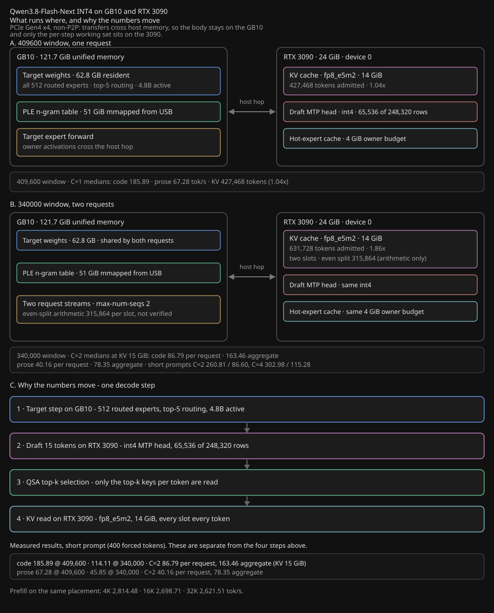
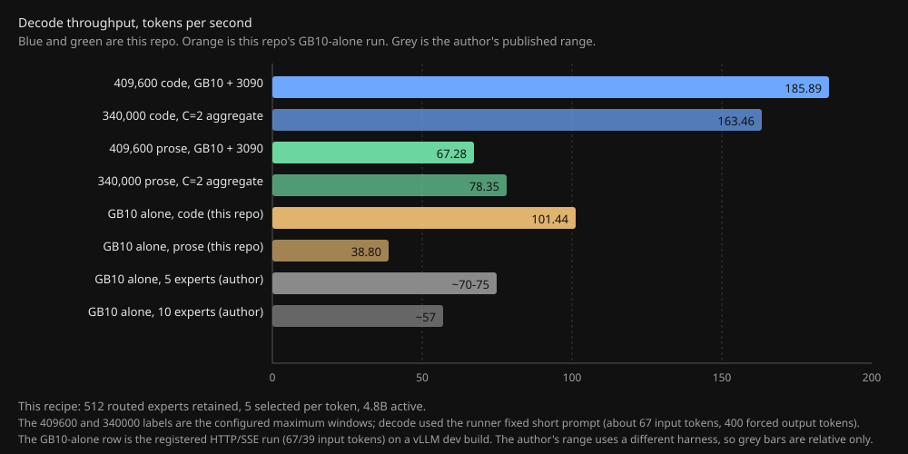
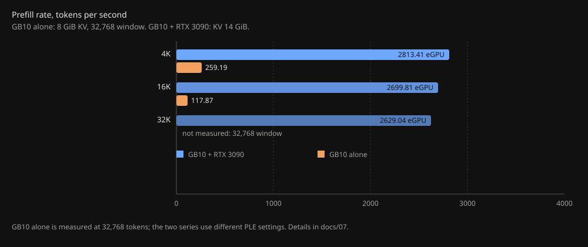

# Qwen3.8-Flash-Next 125B-A5B INT4 on one GB10 + an unlocked RTX 3090 eGPU

A working, measured recipe for serving [`azampatti/Qwen3.8-Flash-Next-125B-A5B-INT4-AutoRound`](https://huggingface.co/azampatti/Qwen3.8-Flash-Next-125B-A5B-INT4-AutoRound) — 125B
parameters total, **4.8B active**, INT4 AutoRound — on a single NVIDIA GB10 with an RTX 3090 attached over
PCIe Gen4 x4 as an eGPU, with the 51 GiB PLE n-gram table mmapped from USB storage.

This checkpoint is not the stock Qwen3.8-Flash-Next quant. The upstream model activates **10 routed
experts per token**, about 6.0B active parameters. This checkpoint activates **5** and then heals the
model afterwards, so it runs at about 4.8B active. The routed expert pool stays at 512; only the
per-token selection width changes. That makes it a **code-first recipe**: draft acceptance is about
85 percent on code and 63 percent on prose, which is why code decode reaches 185.89 tok/s while prose
sits at 67.28. `docs/02-why-prose-is-slower.md` explains the prose bound.







Every performance number here comes from MiaAI-Lab's [`sparkDash`](https://github.com/MiaAI-Lab/sparkDash)
collectors at a pinned commit. The exception is the GB10-alone decode row, which is a registered HTTP/SSE
run of the same checkpoint on a vLLM dev build; the GB10-alone prefill row uses the same sparkDash prefill
collector as the eGPU row, but with a cold PLE table, so it is not a like-for-like comparison. Nothing is a
hand-rolled benchmark and nothing is a best-of-N retry. See `docs/01-measurement-method.md`.

> Status: one-machine recipe. The engine is a fork build, not stock vLLM, and the numbers come from one
> GB10 + RTX 3090 pair. Treat this as a reproducible recipe, not a vendor claim.

## Why this project exists

A single DGX Spark (GB10) is a capable machine, but its decode rate is a fixed ceiling. This project
exists to test whether a **second GPU over eGPU** can lift that ceiling: decode throughput is measured
higher, and prefill may improve too, though the prefill comparison is still pending. The GB10-alone
prefill arm ran with a cold PLE table (`PLE_PREWARM=0`), and one gather of 53,076 rows took 72.4 s,
so that arm measures USB storage latency rather than the GPU. The eGPU prefill artifacts record
`ple_mmap_prewarm: true`, so the two are not comparable until both arms use the same PLE state.

The point is not that Qwen3.8-Flash-Next is the model to use forever. It is that one DGX Spark plus one
external GPU has more headroom than the spec sheet suggests, and the recipe transfers to whatever model
comes next. Qwen3.8-Flash-Next is the test case, not the destination.

### Which eGPUs enumerate on this host

Measured on the GB10 host, not assumed:

| GPU | Enumerates | Note |
|---|---|---|
| RTX 3090, 24 GiB, unlocked BF16 | yes | Used in this recipe |
| CMP 170HX, 64 GiB, unlocked | yes | 16 MB BAR |
| RTX 5060 Ti | no | BAR size |
| RTX 5080 | no | BAR size |
| Two CMP 170HX through a PLX card | no | BAR size |

Both cards that enumerate carry a **16 MB BAR**. The failures are the newer 50-series parts and the
two-card PLX arrangement. The working hypothesis is that a BAR under 32 MB is what enumerates on this
host, but that is inference from four data points, not a specification.

## How this repository was built

This work came out of a small local setup, not a hosted agent service:

- **DeepSeek v4.1 Flash 1017**, running as a worker on two DGX Sparks on the local network, did the code
  reading, the patch writing and the measurement driving.
- **Codex as an advisor**, mostly `6.1 sol` and occasionally `6.1 terra`, reviewed the plan and the
  numbers before they were recorded.
- **Argon**, a web chat, gave feedback on the write-ups and the framing.

Every measurement, every revert and every correction here went through that loop. Where a document says a
claim was withdrawn, it was an advisor or a reviewer that caught it.

## Hardware

| Component | Specification |
|---|---|
| Compute | GB10, SM121, 121.7 GiB unified memory |
| Second GPU | NVIDIA RTX 3090, SM86, 24 GiB GDDR6X, BF16 unlock applied, PCIe Gen4 x4, non-P2P |
| PLE storage | 51 GiB table on USB. The recent and best measurements use the 20 Gbps USB NVMe (`/mnt/nvme20/ple-table-int4`); the 10 Gbps Samsung T7 Shield was the early copy, and both copies are byte-identical |
| Host | 121 GiB RAM, `MemAvailable` ≈ 118 GiB before load |
| Host software | NVIDIA DGX Spark, DGX OS 7.2.3 (build 2025-10-04), Ubuntu 24.04.4 LTS, kernel `6.17.0-1029-nvidia` |
| GPU driver | NVIDIA 615.71.09 |
| Container runtime | Docker 29.2.1 |
| Power and clocks | RTX 3090 limited to **250 W** (card max 430 W); GB10 SM clock capped at **2200 MHz** |

The RTX 3090 carries the hot-expert cache and the KV cache; the GB10 holds the bulk of the weights and
the PLE table's page cache. Non-P2P means transfers between the two cards go through host memory.

## Choose your window

Two configurations cover the trade-off between single-stream speed and configured context.
Decode numbers are sparkDash native medians of three repetitions, measured with the runner's
fixed short prompt (about 67 input tokens, 400 forced output tokens).

| Window | Per-request maximum | Measured decode | Real concurrent capacity | Config |
|---|---:|---|---|---|
| 409,600 x 1 | 409,600 | code **185.89**, prose **67.28** | one full request (`427,468 tokens, 1.04x`) | `sep-f` (code) / `sep-e` (prose), KV 14 GiB |
| 340,000 x 2 | 340,000 | code 86.79, prose 40.16 per request | **not verified at full length** | `sep-c2`, KV 15 GiB |

- **Speed first, 400k context.** One request at 409,600 tokens decodes at 185.89 tok/s for
  code and 67.28 for prose. The pool admits `427,468 tokens, 1.04x`, so exactly one full
  request fits.
- **Context first, 340,000 per request.** The engine is configured for 340,000 tokens per
  request with two concurrent slots, which is 680,000 tokens of configured maximum. The
  pool admits `677,901 tokens, 1.99x` at KV 15 GiB and `631,728 tokens, 1.86x` at KV 14 GiB.
  A non-streaming long-prompt probe with KV 14 GiB sent two requests at 4K, 16K, 32K and
  315,000, and all completed (prompt tokens 4,244, 16,975, 33,940 and 326,260 per stream).
  That probe did not record TTFT overlap, scheduler KV occupancy or preemption, so it does
  not prove simultaneous residency; a streaming run with those fields is required before any
  concurrent total is claimed.

Important limits for the second row: the measured C=2 decode used the runner's fixed short
prompt, and prefill failed at every size (4K, 16K and 32K returned `prefillTps 0`,
`samples 0`). Long-prompt concurrency and long-prompt prefill at this window are therefore
unverified. The per-request decode rates 86.79 (code) and 40.16 (prose) are medians of those
short-prompt runs; the aggregate figures 163.46 and 78.35 are sums of two such streams, not
a measured 680,000-token workload.

The two rows use different engine configurations, and the code and prose peaks come from
different runs, so each row names its config. The exact 400k value is 409,600 tokens.

## Measured recipes

Two engine configurations cover the long windows. Both use the patched 409,600 view.

| Purpose | `--max-model-len` | `--max-num-seqs` | `--kv-mib` | Admission |
|---|---:|---:|---:|---|
| Single 400k request | 409600 | 1 | 14336 | `427,468 tokens, 1.04x` |
| Two 315k requests | 340000 | 2 | 14336 | `631,728 tokens, 1.86x` |

Decode, three repetitions, medians:

| Window | Workload | C=1 | C=2 per request | C=2 aggregate |
|---|---|---:|---:|---:|
| 409,600 | code | **185.89** | — | — |
| 409,600 | prose | **67.28** | — | — |
| 340,000 | code | 114.11 | 86.79 | **163.46** |
| 340,000 | prose | 45.85 | 40.16 | **78.35** |

Prefill on the 14 GiB engine:

| Size | tok/s |
|---|---:|
| 4K | 2,813.41 |
| 16K | 2,699.81 |
| 32K | 2,629.04 |

A non-streaming long-prompt probe with two concurrent streams completed at 4K, 16K, 32K and
315,000 (326,260 prompt tokens per stream on the last run). Simultaneous residency is not
verified by that probe.

Three constraints shape these configurations, all measured rather than assumed:

1. **KV lives on the 24 GiB card.** The engine reserves KV on device 0, so the KV size that fits is capped by
   the card, not by the GB10's 121.7 GiB pool. 14 GiB is the largest value that leaves room for the draft
   model and the prefill workspace.
2. **Prefill batch trades rate for survival.** At 8,192 batched tokens the prefill workspace does not fit and
   the engine core dies at 32K; at 1,024 every size completes.
3. **The window needs a patched view.** The checkpoint's `max_position_embeddings` is 262,144, but a symlinked
   directory with a patched `config.json` sets `max_position_embeddings 409600` and YaRN `factor 1.5625`
   (`= 409600 / 262144`), and the fork's `standardize_rope_params()` reads that value before
   `PretrainedConfig.__init__` runs. Forcing `--max-model-len` without the patched view still dies: draft
   weights (9.09 GiB), target weights (6.19 GiB) and 16 GiB of KV add up to 31.28 GiB on a 24 GiB card.

## What this recipe does differently

- **Serves the checkpoint as-is** — all 512 routed experts retained, top-5 routing, 4.8B active. No
  expert pruning.
- **Keeps PLE outside the weights** — the 51 GiB n-gram table is mmapped from USB with
  `PREWARM=1`, `MADV_RANDOM=0`, 32 mmap workers and 512 fast rows, so the model fits in one GB10.
- **Runs a fork engine** with a resident speculative-decoding path: draft depth 15 for code (fixed at
  the server) and a runtime-selectable prose depth (`k6-open` requests 6, but this engine
  pins the draft depth at 15, which the control snapshot confirms).
- **Measures with `sparkDash`**, not with an ad-hoc harness, and records the engine controls in every
  envelope so a number is always attributable to a configuration.

## Quickstart

```bash
export RECIPE_HOME=/path/to/this/checkout
export MODEL_STORE=/path/to/int4-models          # holds the two model views
export QWEN38_PLE_HOST_DIR=/mnt/nvme20/ple-table-int4   # 20 Gbps USB NVMe

# 1. Build the engine image from the upstream base, then apply this recipe's patches.
#    See engine/Dockerfile.bottleneck and engine/patches/.
# 2. Prepare the two model views: the target (no MTP) and the int4 draft head.
# 3. Start the resident engine.
bash engine/run_resident_a_serve_zw.sh
# 4. Install the pinned measurement dependency, then measure.
(cd bench/sparkdash-exact && npm ci)   # undici 8.11.2, pinned in package-lock.json
python3 bench/run_matrix.py --state-file <name>.json \
    --node bench/sparkdash-runtime/node-v24.22.2-linux-arm64/bin/node \
    --config k6-open --case prose --concurrencies 1 2 4 --repeats 3
```

`engine/Dockerfile.bottleneck` builds on top of the image produced by
[Saren-Arterius/qwen3.8-Flash-DGX-AutoRound](https://github.com/Saren-Arterius/qwen3.8-Flash-DGX-AutoRound)
and applies the patches in `engine/patches/`: per-position draft scale, a guarded diagnostic pre-warm,
and a resident round profile. The engine's vLLM build is `0.1.dev20073+g8e685d198`.

## Context and concurrency

The KV cache lives on the RTX 3090, which is the binding constraint. The 409,600 window
admits `427,468 tokens, 1.04x` at KV 14 GiB, so it serves one full request. The 340,000
window admits `631,728 tokens, 1.86x` at the same KV, so it serves two requests up to
315,864 tokens each when split evenly.

Two requests at 340,000 each need more KV than that pool holds, so two *full-length*
340,000 requests do not fit: a two-stream probe at 339,967 input tokens per request was
rejected with `HTTP 400`. A non-streaming probe did complete two 315,000-token requests
(326,260 prompt tokens each), but it recorded only total wall time, not TTFT overlap or
scheduler KV occupancy, so simultaneous residency is unverified and no concurrent total is
claimed.

There is no single KV setting on a 24 GiB card that serves both deep prefill and a large KV
reservation. Prefill processes thousands of tokens per iteration, so its activation and MoE
workspace sits outside the KV reservation and needs several GiB of headroom that decode does
not. That is why the 340,000 window at KV 15 GiB failed prefill at every size (4K, 16K, 32K
returned `prefillTps 0`) until the pool was lowered to 14 GiB, where the same sizes and a
315,000-token probe all completed.

For the prefill engine, `--max-num-batched-tokens` must be small (1,024) or the activation
workspace grows past what the card can hold. Also note that `PrefillBench` decides whether a
size fits from the request's `contextLength` field, not from the server, so a driver must
pass the engine's real `--max-model-len` there or larger sizes are skipped with a misleading
"does not fit" row.

The 409,600 window needs two changes: the checkpoint's `config.json` gained
`max_position_embeddings 409600` plus YaRN at factor 1.5625, and the fork's
`Qwen3_8FlashNextConfig` was patched so `max_position_embeddings` exists before
`standardize_rope_params()` reads it. KV stays at 14 GiB.

MTP routed experts quantized to int4 recover 3.47 GiB but do not let KV grow past 14 GiB:
17 GiB and 16 GiB both die in the start-up peak. An 8-bit KV cache (`fp8_e5m2`) runs after
patching four QSA places that rejected or misread it; `fp8_e4m3` remains blocked by Triton
on SM86. With `fp8_e5m2` and `--kv-mib 15616`, 409,600 admits 738,180 tokens at 1.80x; 17 GiB
admits 823,701 tokens at 2.01x but fails the KV tensor allocation peak. Details:
`docs/11-concurrency-two.md`.

The decode cost of the wider window is broken down stage by stage in
`docs/12-decoding-regression.md` (English) and `docs/12-decoding-regression.ko.md` (Korean). That
pair records the flags, the measured rates and the candidate causes, so an outside reader can
reproduce the comparison without the session logs.

The six single-variable recovery steps derived from the external PDF feedback, with the verified
code state of each claim and the kept or reverted decision, are in `docs/14-pdf-recovery-ladder.md`.

The four remaining advisory paths measured on top of that ladder, with their reverts and the adopted
combination, are in `docs/16-recovery-paths-results.md` (English) and
`docs/16-recovery-paths-results.ko.md` (Korean).

The independent review request covering every run record in those pages, including the failed
prefill runs, is in `docs/17-advisory-review-brief.md` and `docs/17-advisory-review-brief.ko.md`.

The device placement for both configurations, with the diagram of what sits on the GB10 and
what sits on the RTX 3090, is in `docs/18-deployment-map.md`, `docs/18-deployment-map.ko.md`
and `docs/18-deployment-map.svg`.

## Results

All tables and their artifact paths are in `docs/06-results.md`. Headline numbers, warm
engine, sparkDash native runner. The 409,600 rows were measured at KV 14 GiB; the 340,000
rows were measured at KV 15 GiB (`677,901 tokens, 1.99x`), and the 14 GiB admission
(`631,728 tokens, 1.86x`) is a separate configuration:

| Window | Workload | C=1 | C=2 per request | C=2 aggregate | KV |
|---|---|---:|---:|---:|---:|
| 409,600 | code | **185.89** | — | — | 14 GiB |
| 409,600 | prose | **67.28** | — | — | 14 GiB |
| 340,000 | code | 114.11 | 86.79 | **163.46** | 15 GiB |
| 340,000 | prose | 45.85 | 40.16 | **78.35** | 15 GiB |

| Prefill (340,000 engine) | 4K | 16K | 32K |
|---|---:|---:|---:|
| tok/s | 2,813.41 | 2,699.81 | 2,629.04 |

Short-prompt concurrency (`sep-g`, the runner's fixed 67-token prompt plus 400 forced output
tokens), three repetitions, medians:

| Workload | C=2 per request | C=2 aggregate | C=4 per request | C=4 aggregate |
|---|---:|---:|---:|---:|
| code | 149.00 | **260.81** | 91.82 | **302.98** |
| prose | 44.17 | **86.60** | 30.53 | **115.28** |

Every row reports `streamsFailed == 0`. These measure concurrency on a short prompt, not
long-context residency.

Summary of what the numbers mean:

- The 409,600 window serves one full request. The 340,000 window has two configured slots, and
  two 315,000-token requests completed, but simultaneous residency is unverified.
- Prose is bounded by draft acceptance, not by memory bandwidth: `docs/02-why-prose-is-slower.md`.
- Cold-start has five specific causes and six boot-time fixes, of which this engine implements a
  subset: `docs/03-cold-start-analysis.md`.
- PLE storage A/B: the 20 Gbps copy is faster at raw I/O and at boot pre-warm, but steady-state decode
  is within cold-start noise once the table is in RAM: `docs/04-ple-storage-t7-vs-20gbps.md`.

## Reference: the single-GB10 recipe

The published single-GB10 recipe for this model is
[`azampatti/Qwen3.8-Flash-Next-Int4-FAST`](https://github.com/azampatti/Qwen3.8-Flash-Next-Int4-FAST/tree/main).
It cuts the routed experts from 10 to 5 per token (4.8B active) and reports about 70-75 tok/s on
one DGX Spark with Eugr's b12x stack, and about 70 tok/s on its own image. The same page puts the
original 10-expert model at about 57 tok/s.

| Recipe | Routed experts per token | Active parameters | Decode |
|---|---:|---:|---:|
| This recipe, 409,600 code | 5 | 4.8B | **185.89 tok/s** |
| This recipe, 409,600 prose | 5 | 4.8B | **67.28 tok/s** |
| GB10 alone, same checkpoint, HTTP/SSE, short prompt | 5 | 4.8B | code ~101 / prose ~39 tok/s |
| Single GB10, 5 experts, b12x | 5 | 4.8B | ~75 tok/s |
| Single GB10, 5 experts, own image | 5 | 4.8B | ~70 tok/s |
| Single GB10, original 10 experts | 10 | 6.0B | ~57 tok/s |

The code-over-prose gap also appears on a single GB10. The same checkpoint on one GB10, measured with the
HTTP/SSE collector at 67 input tokens for code and 39 for prose, gives code about 101 tok/s and prose
about 39 tok/s: code is roughly 2.6x prose there too. That row is not sparkDash and not this fork's engine;
it is the registered `mia-a5b-gb10-int4mtp6-api-q1` run on a vLLM dev build. The 85 percent code and
63 percent prose draft acceptance are the model author's published figures, not measurements here, so the
gap is attributed to that checkpoint's routing rather than proven by this recipe.

Both recipes run 5 selected experts per token, but the harnesses and workloads differ: this table's
numbers are sparkDash medians on this machine, and the reference figures are that repository's own
published ranges on one GB10. The comparison is relative, not a same-condition ratio.

The reference page also puts the original 10-expert model at about 57 tok/s, but that is a different
checkpoint with 6.0B active parameters and a different harness, so it is not a like-for-like baseline
for this recipe's 185.89.

### Community reception

The model author keeps an active thread on the NVIDIA developer forums,
[Up to 70tok/s Qwen3.8-Flash-Next-Int4-AutoRound](https://forums.developer.nvidia.com/t/up-to-70tok-s-qwen3-8-flash-next-int4-autoround/382733),
with 333 posts and about 23,000 views. It is the practical place to check whether the checkpoint is still
being improved and what other DGX Spark owners see on the same hardware.

Independent users post their own numbers there. One tool-eval-bench run on this checkpoint scored 94/100,
and other Spark owners report code speeds in the 60-70 tok/s band with their own harnesses. Those are
not this harness's numbers and are not comparable line by line, but they show the checkpoint is in real
day-to-day use rather than a one-off upload.

## Verification

Ported from
[`MiaAI-Lab/Qwen3.8-Flash-Next-Single-DGX-Spark-TensorFold`](https://github.com/MiaAI-Lab/Qwen3.8-Flash-Next-Single-DGX-Spark-TensorFold)
at commit `20e15e41` (MIT): exactness across serial / concurrent / draft-off, cross-build exactness,
tool-call stability, needle retrieval at 16K, prompt reuse, and the context boundary. Vision is not
applicable to this text-only recipe. Details and exit-code semantics: `docs/05-verification.md`.

## Layout

```
docs/       measurement method, prose analysis, cold-start analysis, storage A/B, verification, results,
            GB10-alone versus eGPU comparison, context-extension advisory brief
analysis/   the bundled PDF and its cleaned transcription
engine/     Dockerfile, patches, resident benchmark, launchers
bench/      the pinned sparkDash closure + source lock + runner + run_matrix.py
verify/     TensorFold-derived checks, adapted for the served window
artifacts/  raw envelopes, execution records, verification results
```

## Credits

This repository is a small thing standing on other people's much larger work. Thank you to:

- **azampatti**, for the INT4 AutoRound checkpoint and the single-GB10 Int4-FAST recipe. This whole
  exercise started from that quant; the code-first behaviour, the 5-of-512 expert selection and the
  healing step are theirs.
- **MiaAI-Lab**, for `sparkDash` and for the TensorFold single-DGX-Spark recipe. Every number here was
  collected with their harness at a pinned commit, and the verification suite is ported from their work.
- **The vLLM maintainers**, for the engine this fork is built on. The QSA attention path, the paged KV
  cache and the scheduler are theirs; this fork's patches are small and local.
- **Eugr**, for the b12x single-Spark stack that the author's published GB10-alone range uses.
- **Zagitta**, for [gpu-unlock](https://github.com/Zagitta/gpu-unlock), which is how the RTX 3090 BF16
  unlock used here works.
- **amoghmunikote**, for [cmpunlocker](https://github.com/amoghmunikote/cmpunlocker), which is how the
  CMP 170HX unlock works.
- **NVIDIA**, for the GB10 hardware and the tooling behind the unified-memory measurements.

If any of this is useful, the credit belongs to them. If something here is wrong, the mistake is mine.

## License

MIT for this repository's own code. Third-party scopes and texts: `THIRD_PARTY_NOTICES.md`. The
`bench/sparkdash-exact/` files are Apache-2.0 (sparkDash 2.0.0+); the `verify/` tools are MIT
(MiaAI-Lab). Model weights and the base engine image are not redistributed here.
